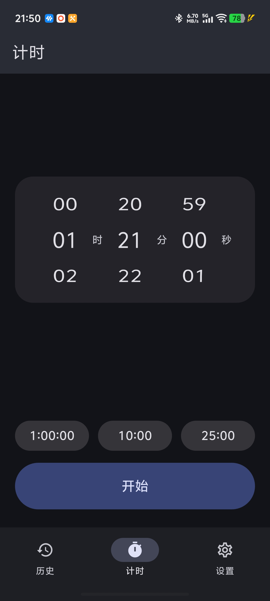
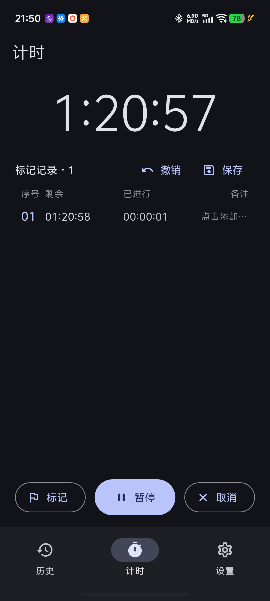
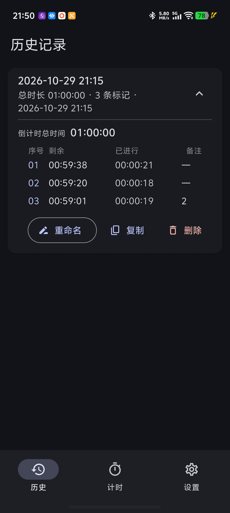

# 计时器 TimerStopwatch

一款专注**时间段标记**的安卓倒计时应用。不只是"到点响铃"——倒计时进行中随时点「标记」记录时间节点（不打断计时），每条标记记录该节点的剩余时间与**距上一条标记的间隔**，让你清楚每个阶段花了多久，事后可保存到历史记录并一键复制导出为表格文本。

Flutter 实现，Material 3、仅中文、跟随系统深色模式、竖屏锁定。MIT 协议开源。

## 界面预览

<p align="center">
  
  
  
</p>

## 应用场景

- **考试 / 刷题训练**：按考试时长倒计时，每个模块（资料分析、言语、判断……）做完点一下「标记」，结束后每题型的真实耗时一目了然——这正是本 App 的诞生场景。
- **结构化学习 / 阅读**：番茄式分段计时，标记每个章节/任务的用时，导出后复盘时间分配。
- **烹饪 / 烘焙**：多阶段菜谱（腌制 30 分、烘烤 20 分、静置 10 分），每完成一步标记一次。
- **运动训练**：组间休息、HIIT 循环计时，记录每组实际用时。
- **任何需要"倒计时 + 分段记录"的场景**：比系统计时器多了标记与导出，比秒表多了到点提醒。

## 主要功能

| 功能 | 说明 |
|------|------|
| ⏱ 时长滚轮 + 快捷预设 | 时/分/秒滚轮（逐格震动 + 咔哒声反馈），最近使用自动置顶，预设无限缓存、长按拖动排序 |
| 🚩 时间段标记 | 倒计时中随时标记，不打断计时；每条 = `序号 \| 剩余 \| 与上一条的间隔 \| 备注`，时间和备注都可随时编辑 |
| 💾 历史记录 | 会话命名保存，后续标记自动追加；复制导出为 TSV 表格文本；支持重命名 / 多选删除 |
| 🔔 剩余提醒 | 多阈值（出厂默认剩余 30 分、10 分），每阈值可独立指定系统音或导入音频，各只触发一次 |
| 🎓 考试模式 | 一键切换：开始、剩余 15 分钟、最后 10 秒自动播放考试音频（开始/剩 15 分提醒/收卷提醒），其余提醒停用 |
| 🌙 伪熄屏常亮 | 倒计时中无操作自动进入全屏纯黑 + 暗字显示，定时漂移防烧屏，点击即回 |
| 🪟 后台悬浮窗 | 切后台弹出半透明悬浮窗实时显示剩余时间，可拖动、可关闭，通知栏可直接「标记」 |
| 🔕 勿扰联动 | 开始倒计时自动开勿扰、结束恢复；响铃走闹钟声道确保勿扰下可闻 |
| ⏰ 到点必响 | 前台 / 后台前台服务 / 进程被杀（精确闹铃兜底）三条路径均循环响铃直至手动关闭 |
| 💾 会话恢复 | 计时中/暂停中退出并杀掉应用，重开自动恢复到原状态（剩余、标记、已触发提醒都保留） |

## 下载与构建

```bash
flutter pub get
flutter test                                            # 单元测试（40 项）
flutter test integration_test/app_e2e.dart -d <设备>    # E2E 冒烟
flutter build apk --release --split-per-abi             # arm64-v8a 给真机
```

要求 Flutter stable（Dart ≥ 3.13）、Android SDK 34+。minSdk 24（Android 7.0）。

## 项目结构

每个目录都有 README 说明文件职责与影响，随项目持续更新：

- [`lib/`](lib/README.md) — Dart 源码（Riverpod 分层：ui → controllers → models/services）
- [`android/.../kotlin/`](android/app/src/main/kotlin/com/timerstopwatch/timerstopwatch/README.md) — 原生前台服务 / 响铃 / 悬浮窗 / 滚轮震动反馈
- [`test/`](test/README.md) — 单元与 golden 测试
- 计时核心：单调时钟差值推算（改系统时间不影响计时）；图标"代码即资源"（`app_icon.dart` → golden 渲染 PNG）

## About

- 作者主页：<https://github.com/zy8270>
- 本仓库：<https://github.com/zy8270/timerstopwatch>
- 协议：[MIT](LICENSE) — 可自由使用、修改、分发，欢迎 Star / Issue / PR

## 免责声明

按 MIT 协议"现状"提供，不附带任何保证；请勿将其用于对计时精度有安全要求的场合（如医疗、工业控制）。
